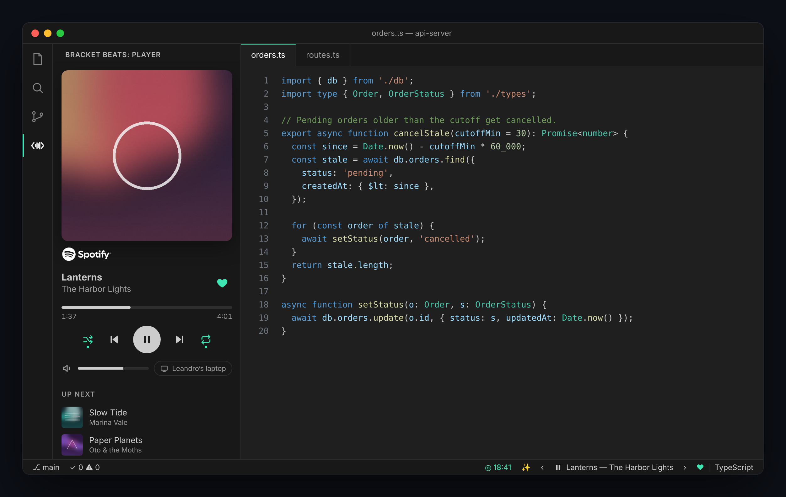
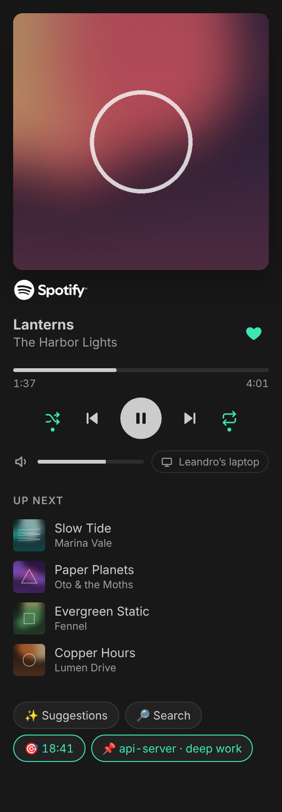
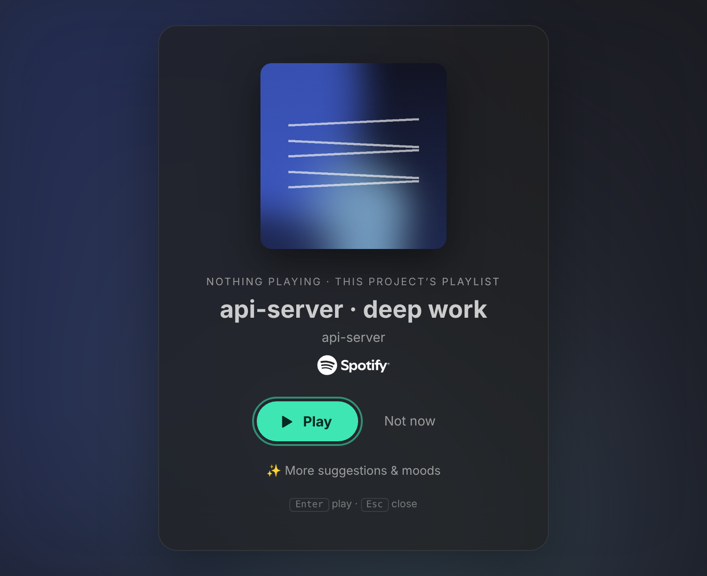
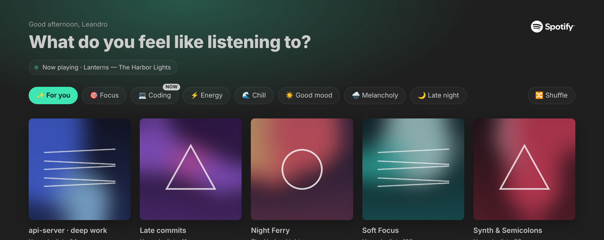

# Bracket Beats for Spotify

*A music player for Spotify, made for coders.*

See what's playing, control playback without leaving the editor, and get music suggestions based on your taste, the project you have open and the time of day.



- **Status bar**: current song, previous / next, play / pause and ♥.
- **Sidebar player** (the `< ∿ >` icon on the left): cover art, seekable progress, shuffle, repeat, volume, device and up next.
- **Suggestions & moods** (`Ctrl+Alt+M`): "For you", built-in moods and your own; it learns from what you pick.
- **Made for coding**: a playlist per project, local listening history, focus sessions and "save this session as a playlist".
- English and Portuguese.

> Requires **Spotify Premium** and Spotify open on some device (desktop app, phone or web player). Bracket Beats controls that device; it does not play audio inside VS Code.

## Getting started

Click **Connect Spotify** in the status bar. A 3-step wizard does the rest:

1. **Create an app**: it opens the Spotify developer dashboard. Click **Create app**; any name and description will do.
2. **Redirect URI**: already copied for you (`http://127.0.0.1:8888/callback`). Paste it under **Redirect URIs** → **Add** → tick **Web API** → **Save**.
3. **Client ID**: copy it from the top of **Basic Information** and paste it into the wizard. No client secret needed: sign-in uses PKCE.

Your browser opens to authorise, and you're done. Why your own app? Spotify limits new apps to 5 users each, so everyone uses their own, which takes about a minute.

## Player



| | Where |
|---|---|
| Play / pause, previous, next | Status bar, sidebar, commands |
| ♥ Like / unlike | Status bar, sidebar, **Bracket Beats: Like / unlike song** |
| Seek | Click the progress bar (or ← → when it's focused) |
| Shuffle, repeat (off → playlist → song) | Sidebar, commands |
| Volume | Sidebar, **Bracket Beats: Volume up / down** (on devices that allow it) |
| Device | Sidebar, **Bracket Beats: Choose device** |
| Queue | Sidebar ("Up next"), **Bracket Beats: Show queue** (read only: the API can't jump within the queue) |
| Search | `Ctrl+Alt+S`. Enter plays; the **+** button on a song adds it to the queue |

<br clear="right">

## Suggestions

**When VS Code opens** and nothing is playing, it suggests, in order: this project's playlist → what you usually play in this project (at this hour, if there's enough data) → your last playlist or album → your last song.



**In the panel** (✨ or `Ctrl+Alt+M`):



- **For you**: project playlist (📌) → habits from your local history → your playlists ranked by the artists you listen to, with variety → public playlists of your artists.
- **Moods**: Focus, Coding, Energy, Chill, Good mood, Melancholy, Late night, plus your own. The one tagged "NOW" depends on the time of day.
- On each cover: **📌** attaches it to the project, **✕** hides it from suggestions.
- It **learns**: what you pick moves up; what keeps showing and never gets picked moves down.
- **🔀 Shuffle** asks for different suggestions.

**Your own moods**:

```json
"bracketBeats.customMoods": [
  { "label": "Metal", "emoji": "🤘", "query": "metal classics", "keywords": ["metal"] },
  { "label": "Fado" }
],
"bracketBeats.hiddenMoods": ["melancolia"]
```

`query` is what gets searched on Spotify (defaults to the name); `keywords` find matching playlists of yours.

## Made for coding

- **Project playlist**: **Bracket Beats: Set playlist for this project** (or 📌). It becomes the first suggestion whenever you open that folder or workspace.
- **Local history**: each song that starts while VS Code is focused is saved with the time, project and file language. It stays on your computer (up to 5,000 songs) and powers per-project and per-hour suggestions. Turn it off with `bracketBeats.history.enabled`, or wipe it with **Bracket Beats: Clear local history**.
- **Focus sessions** (**Bracket Beats: Focus session**): a pomodoro timer in the status bar. Music plays while you focus and pauses on breaks.
- **Save session as playlist**: pick a range (focus session, since this window opened, today in this project, today, last 2 hours) and get a private playlist without duplicates.
- **Bracket Beats: Show my taste profile** shows the genres and artists the suggestions are based on.

## Reliable by design

- **Many windows**: only the focused window talks to Spotify; the others read a shared file. Signing in or out in one window applies to all.
- **Sessions survive hiccups**: network errors, Spotify outages and rate limits don't sign you out. Spotify's `Retry-After` is respected.
- **Light on the API**: adaptive polling, interpolated progress, and caches on disk.
- **Remote friendly**: runs on your local machine (`extensionKind: ui`), so sign-in works in WSL, SSH and Codespaces.

## Settings

| Setting | Default |
|---|---|
| `bracketBeats.language` | `auto` (follows VS Code), `pt` or `en` |
| `bracketBeats.clientId` | set by the wizard |
| `bracketBeats.redirectPort` | `8888` (if you change it, update the Redirect URI in your Spotify app too) |
| `bracketBeats.suggestOnStartup` | `true` |
| `bracketBeats.suggestionStyle` | `card` (cover card, no sound), `modal`, `quickpick` or `notification` |
| `bracketBeats.pollIntervalSeconds` | `5` |
| `bracketBeats.statusBarButtons` | `["suggestions", "previous", "next", "like"]` |
| `bracketBeats.history.enabled` | `true` |
| `bracketBeats.focus.workMinutes` / `breakMinutes` | `25` / `5` |
| `bracketBeats.focus.pauseOnBreak` | `true` |
| `bracketBeats.customMoods` / `hiddenMoods` | `[]` |

## Privacy

Sign-in tokens are kept in VS Code's secret storage. Your listening history, suggestion feedback and caches are stored locally in VS Code's extension storage and never leave your computer. The extension only talks to Spotify.

## Spotify limits

- Needs Spotify Premium for playback control.
- Spotify no longer offers recommendations, audio features or editorial playlists to new apps, so suggestions are computed from your own data.

---

Bracket Beats is not affiliated with, endorsed by or sponsored by Spotify. Spotify is a trademark of Spotify AB.

Documentação em português: [README.pt.md](README.pt.md).
