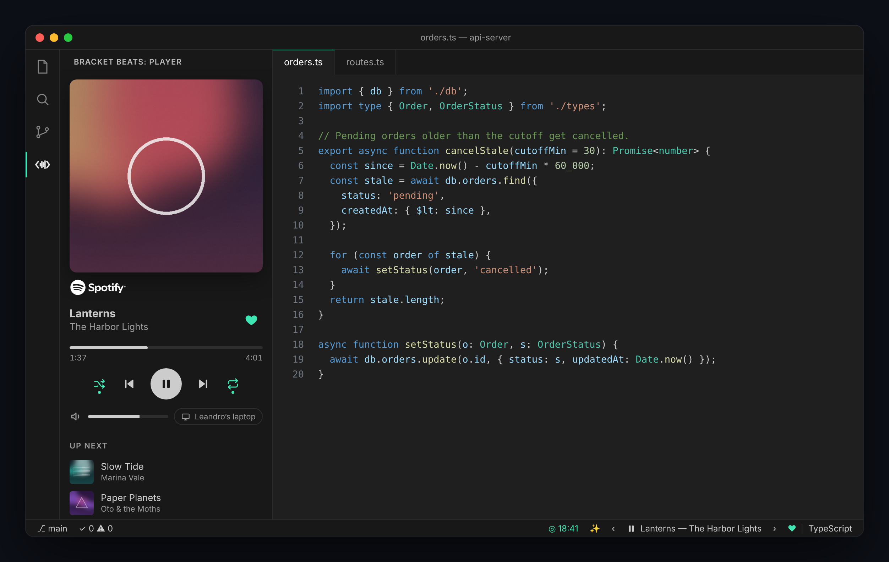
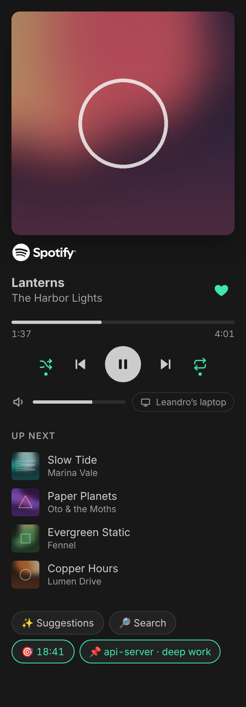
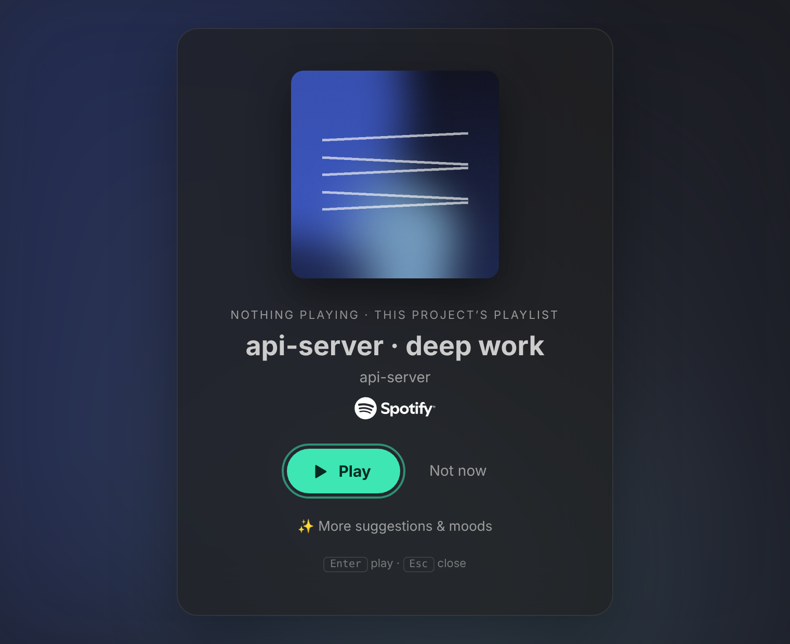
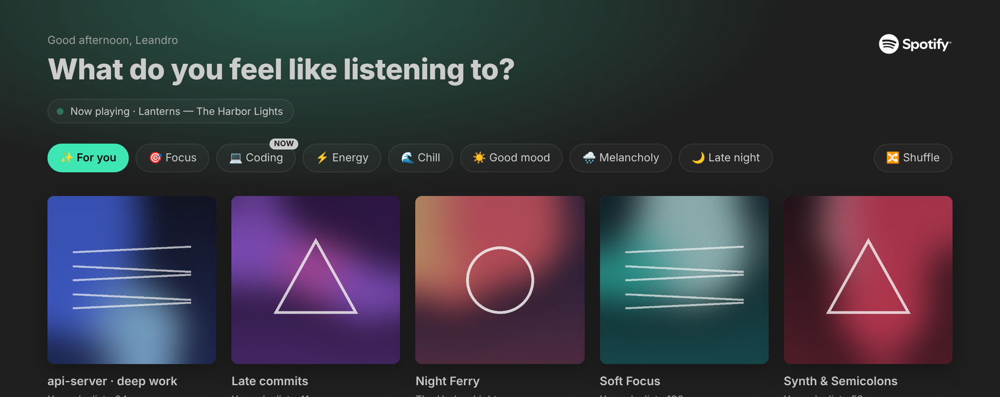

# Bracket Beats for Spotify

*Player de música para Spotify, feito para quem programa.* [English](README.md)

Player do Spotify dentro do VS Code, pensado para quem programa: mostra o que está a tocar, controla tudo sem sair do editor, e sugere música a partir dos teus gostos, do projeto que tens aberto e da hora do dia.



- **Barra de estado**: música atual, ‹ ›, play/pause e ♥.
- **Barra lateral** (ícone `< ∿ >` à esquerda): capa, progresso clicável, aleatório, repetir, volume, dispositivo e as próximas músicas.
- **Sugestões e moods** (`Ctrl+Alt+M`): "Para ti", moods de origem e os teus, aprende com o que escolhes.
- **Contexto de programação**: playlist por projeto, histórico local, sessões de foco e guardar a sessão como playlist.

## 1. Ligar o Spotify (uma vez)

Clica em **Ligar Spotify** na barra de estado. Um assistente de 3 passos trata do resto:

1. **Criar a app**: abre o dashboard do Spotify (a conta tem de ter **Premium**). Clica em **Create app**; nome e descrição à escolha.
2. **Redirect URI**: o assistente já o copiou (`http://127.0.0.1:8888/callback`). Cola-o em **Redirect URIs** → **Add** → marca **Web API** → **Save**.
3. **Client ID**: copia-o do topo de **Basic Information** e cola-o no assistente. Não precisas do Client Secret, o login usa PKCE.

A seguir abre-se o browser para autorizares. Para trocar de app mais tarde: **Bracket Beats: Configurar ligação**.

## 2. Desenvolver

```bash
npm install
npm test          # compila e corre os testes (API do Spotify e do VS Code simuladas)
code .            # F5 abre uma janela com a extensão carregada
npm run package   # gera o .vsix
```

## Player



| | Onde |
|---|---|
| Play/pause, anterior, seguinte | Barra de estado, barra lateral, comandos |
| ♥ Gostar / deixar de gostar | Barra de estado, barra lateral, **Bracket Beats: Gostar / deixar de gostar** |
| Avançar na música | Clicar na barra de progresso (ou ← → com ela selecionada) |
| Aleatório, repetir (desligado → playlist → música) | Barra lateral, comandos |
| Volume | Barra lateral, **Bracket Beats: Subir/Baixar volume** (só em dispositivos que o permitam) |
| Dispositivo | Barra lateral, **Bracket Beats: Escolher dispositivo** |
| Fila | Barra lateral ("A seguir"), **Bracket Beats: Ver fila** (só leitura: a API não deixa saltar na fila) |
| Procurar | `Ctrl+Alt+S`. Enter toca; o botão **+** numa música acrescenta-a à fila |

Os botões extra da barra de estado escolhem-se em `bracketBeats.statusBarButtons`.

<br clear="right">

## Sugestões

**Ao abrir o VS Code**, se nada estiver a tocar, sugere por esta ordem: a playlist do projeto → o que costumas ouvir neste projeto (a esta hora, se houver dados) → a última playlist/álbum → a última música (dentro do álbum).



**No painel** (✨ ou `Ctrl+Alt+M`):



- **Para ti**: playlist do projeto (📌) → hábitos do histórico local → as tuas playlists pelos artistas que ouves, com diversidade → playlists públicas dos teus artistas.
- **Moods**: Foco, A programar, Energia, Chill, Bom humor, Melancolia, Noite, e os teus. O marcado "AGORA" depende da hora.
- Por cima de cada capa: **📌** associa ao projeto, **✕** esconde das sugestões. **Bracket Beats: Voltar a mostrar playlists escondidas** desfaz.
- **Aprende**: o que escolhes sobe; o que aparece muitas vezes e nunca escolhes desce.
- **🔀 Baralhar** pede outras sugestões.

**Moods teus** (`bracketBeats.customMoods`):

```json
"bracketBeats.customMoods": [
  { "label": "Metal", "emoji": "🤘", "query": "metal classics", "keywords": ["metal"] },
  { "label": "Fado" }
],
"bracketBeats.hiddenMoods": ["melancolia"]
```

`query` é o que se pesquisa no Spotify (por defeito, o nome); `keywords` encontra playlists tuas desse mood.

## Contexto de programação

- **Playlist do projeto**: **Bracket Beats: Definir playlist deste projeto** (ou 📌 no painel/barra lateral). Fica guardada por pasta/workspace e passa a ser a primeira sugestão ao abrir esse projeto.
- **Histórico local**: cada música que começa a tocar com o VS Code em foco é registada com a hora, o projeto e a linguagem do ficheiro ativo. Fica só no teu computador (até 5000 músicas). Desliga-se em `bracketBeats.history.enabled`; **Bracket Beats: Apagar histórico local** limpa tudo. Músicas ouvidas com o VS Code em segundo plano não contam.
- **Sessões de foco** (**Bracket Beats: Sessão de foco**): pomodoro com contagem na barra de estado. A música toca no foco e pausa no intervalo (se a pausares tu, não volta sozinha). Duração em `bracketBeats.focus.*`.
- **Guardar sessão como playlist**: escolhe o período (sessão de foco, desde que abriste a janela, hoje neste projeto, hoje, últimas 2 horas) e cria uma playlist privada sem repetições. No fim podes associá-la ao projeto.
- **Bracket Beats: Ver o meu perfil de gostos** mostra os géneros, artistas e o que mais ouves neste projeto.

## Robustez

- **Várias janelas**: só a janela em foco fala com o Spotify; as outras leem um ficheiro partilhado. A sugestão ao arrancar aparece numa só janela, e o login/logout propaga-se a todas.
- **Tokens**: renovações em simultâneo partilham um pedido; se outra janela já renovou, usa os tokens dela. Falhas temporárias (rede, 5xx, 429) já não terminam a sessão, só um "refresh token" recusado.
- **Rate limit**: depois de um 429 espera o tempo indicado pelo Spotify (`Retry-After`) sem fazer pedidos.
- **Polling adaptativo**: 5 s a tocar, mais espaçado em pausa ou sem nada, e pergunta logo a seguir ao fim da música. O progresso é interpolado sem pedidos.
- **WSL / SSH / Codespaces**: a extensão corre sempre no teu computador (`extensionKind: ui`), por isso o login e o browser estão na mesma máquina.
- **Cache**: os artistas de cada playlist ficam guardados e só se recalculam quando a playlist muda; nomes e capas também.

## Definições

| Definição | Por defeito |
|---|---|
| `bracketBeats.language` | `auto` (segue o VS Code), `pt` ou `en` |
| `bracketBeats.clientId` | — (o assistente preenche) |
| `bracketBeats.redirectPort` | `8888` (se mudares, muda também o Redirect URI na app do Spotify) |
| `bracketBeats.suggestOnStartup` | `true` |
| `bracketBeats.suggestionStyle` | `card` (cartão com capa, sem som), `modal`, `quickpick` ou `notification` |
| `bracketBeats.pollIntervalSeconds` | `5` |
| `bracketBeats.statusBarButtons` | `["suggestions", "previous", "next", "like"]` |
| `bracketBeats.history.enabled` | `true` |
| `bracketBeats.focus.workMinutes` / `breakMinutes` | `25` / `5` |
| `bracketBeats.focus.pauseOnBreak` | `true` |
| `bracketBeats.customMoods` / `hiddenMoods` | `[]` |

## Idiomas

Português e inglês. Textos da extensão em `src/i18n.ts` (escolhidos por `bracketBeats.language`); nomes dos comandos e descrições das definições em `package.nls*.json` (seguem sempre o idioma do VS Code, é uma limitação do VS Code).

## Estrutura

```
src/
  extension.ts   ativação, comandos e ligação entre as peças
  auth.ts        login PKCE, tokens partilhados entre janelas, renovação segura
  setup.ts       assistente de ligação
  spotify.ts     cliente da Web API (rate limit, player, biblioteca, pesquisa)
  player.ts      estado e polling adaptativo, partilhado entre janelas
  store.ts       ficheiros partilhados entre janelas (estado, histórico, caches, cadeados)
  statusbar.ts   barra de estado
  sidebar.ts     player na barra lateral
  card.ts        cartão de sugestão ao arrancar
  picker.ts      painel de sugestões e moods
  recommender.ts "Para ti", moods, diversidade, feedback
  suggest.ts     sugestão ao arrancar
  history.ts     histórico local e cache de nomes/capas
  feedback.ts    aprender com o que escolhes e escondes
  project.ts     playlist por projeto
  focus.ts       sessões de foco
  brand.ts       atribuição ao Spotify (logótipo oficial)
  migrate.ts     traz definições e histórico do antigo "Spotify Now"
  actions.ts     pesquisa, dispositivos, fila, guardar sessão, foco
  i18n.ts        traduções
test/            npm test (node:test, sem dependências)
```

## Marca Spotify

As regras de marca do Spotify exigem o logótipo oficial junto ao conteúdo. Antes de publicar, descarrega-o em [developer.spotify.com/design](https://developer.spotify.com/design) e põe `logo-white` e `logo-black` (SVG ou PNG) em `media/spotify/`. Sem eles aparece o nome "Spotify" em texto e o empacotamento mostra um aviso.

Bracket Beats não é um produto do Spotify nem é apoiado pelo Spotify.

## Limites do Spotify

- Precisas de **Premium** e do Spotify aberto num dispositivo (app, telemóvel ou web player). A extensão controla esse dispositivo; não toca música dentro do VS Code.
- Cada pessoa usa a sua própria app (Development Mode: 5 utilizadores por app).
- Sem recomendações prontas, audio features nem playlists editoriais para apps novas: as sugestões são calculadas a partir dos teus dados.
